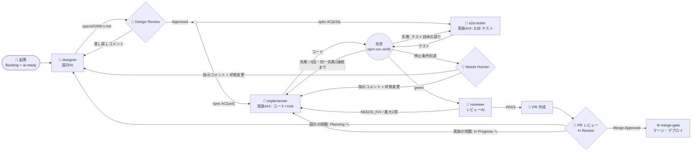

# Workflow Graph（グラフエンジニアリング）

AI と人のノード、その間のエッジ（受け渡し物）と遷移条件の定義。
`.claude/commands/` の各コマンドはこのグラフを実行するオーケストレーターである。

## ノード
| ノード | 担当 | 入力 | 出力 |
|---|---|---|---|
| designer | `.claude/agents/designer.md` | Issue 本文・コメント・docs | `specs/GAM-n.md` |
| implementer | `.claude/agents/implementer.md` | spec の `[unit]` 受入条件 / 失敗ログ | `src/**`, `tests/unit/**`, 進捗ノート |
| e2e-tester | `.claude/agents/e2e-tester.md` | spec の `[e2e]` 受入条件 | `tests/e2e/**` |
| 合流（verify） | オーケストレーター（`/implement`） | 両者の成果物 | `npm run verify` の結果 |
| reviewer | `.claude/agents/reviewer.md` | `git diff main...HEAD`、spec、進捗ノート | PASS / NEEDS_FIX |
| merge-gate | `.github/workflows/linear-merge-gate.yml` | `Merge Approved` の Issue | マージ・デプロイ |

## エッジの遷移条件
| 遷移 | 条件 |
|---|---|
| Design Review → 実装 | 人が Linear で `Approved` に移動 |
| 実装の並列分岐 | spec の受入条件を `[unit]` と `[e2e]` タグで振り分け。両者は書き込み先ディレクトリが重ならない |
| 合流 → 修正 | verify 失敗。失敗がテストコード自体の誤り（仕様と矛盾するテスト）なら e2e-tester、それ以外は implementer |
| 合流 → Needs Human | 修正の通算 5 回到達、または同一失敗シグネチャが 2 連続（進捗ノートで判定） |
| reviewer → implementer | high の指摘あり（最大 2 周、超えたら Needs Human） |
| In Review → 再設計 | 人がコメントして `Planning` に移動 |
| In Review → 再実装 | 人がコメントして `In Progress` に移動 |
| Needs Human → 再開 | 人が指示をコメントし、`Planning`（設計から）または `In Progress`（実装から）に移動 |

## 人の指示の見分け方
Linear MCP は人のアカウントで動くため、投稿者では区別できない。
**AI のコメントは必ず `🤖` で始める**。最新の `🤖` コメントより新しい、`🤖` で始まらないコメントを「未対応の人の指示」とみなす。

## PR 上の自動チェック
PR ごとに次のチェックが並列に走る。merge-gate（`scripts/linear-merge-gate.mjs`）は失敗したチェックがあると自動マージせず `Needs Human` にする。

| チェック | ワークフロー | 失敗条件 | 失敗時 |
|---|---|---|---|
| `CI / verify` | ci.yml | `npm run verify` 失敗 | マージゲートが Needs Human |
| `CI / npm-audit` | ci.yml | high 以上の脆弱な依存 | 同上 |
| `AI Review / review` | ai-review.yml | （失敗させない。コメントのみ） | — |
| `Security Review / security-gate` | security-review.yml | HIGH の指摘、監査未完了、fork PR | 同上 |

取り込み元と更新手順: `.github/security-review/` の各ファイルのヘッダーにある anthropics/claude-code-security-review の SHA を見て、上流の差分を確認してから取り込み直す（`scripts/security-review/findings.mjs` の除外ルールの移植も同様）。
